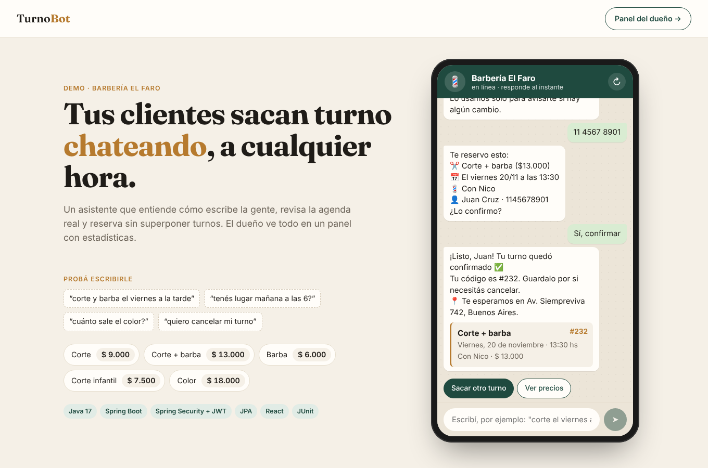
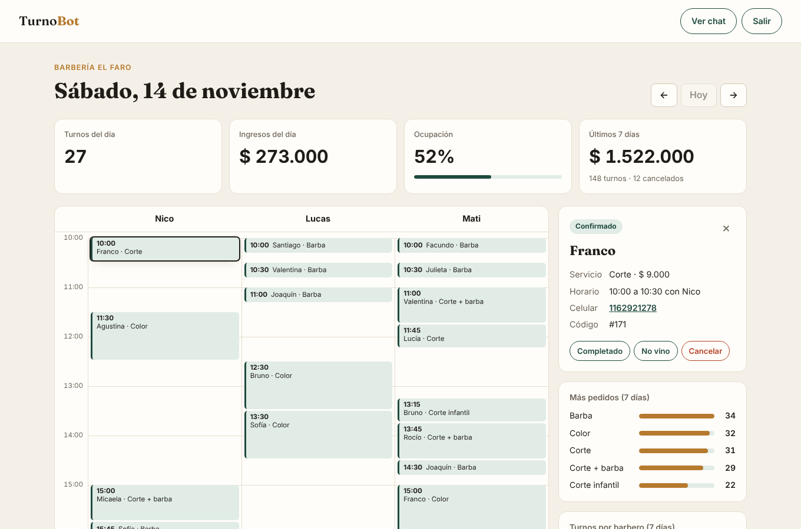

# 💈 TurnoBot: turnos por chat para negocios

Asistente que atiende a los clientes de un negocio por chat, **entiende cómo escribe la gente**, revisa la agenda real y reserva turnos sin superponerlos. El dueño tiene un **panel con la agenda del día y estadísticas**.

La demo está armada para una barbería, pero las reglas (horarios, días, servicios y precios) se cambian por configuración, así que sirve para cualquier rubro que trabaje con turnos.



## Qué hace

**Para el cliente (chat):**
- Entiende frases completas: *"corte y barba el viernes a la tarde con Lucas"* llena servicio, día, franja y barbero en un solo mensaje.
- Pregunta solo lo que falta y ofrece botones de respuesta rápida.
- Sugiere horarios cercanos si el pedido está ocupado, y otros días si no hay lugar.
- Cancela turnos con el código y el celular (los dos tienen que coincidir).
- Responde precios, horarios y dirección.

**Para el dueño (panel con login):**
- Agenda del día con una columna por barbero y una línea que marca la hora actual.
- Marca turnos como completados, ausentes o cancelados.
- Estadísticas: turnos e ingresos del día, ocupación, últimos 7 días, servicios más pedidos y carga por barbero.



## Tecnologías

| Parte | Tecnología |
|---|---|
| Backend | Java 17, Spring Boot 4, Spring Data JPA, Bean Validation |
| Seguridad | Spring Security + JWT (jjwt), contraseñas con BCrypt |
| Base de datos | H2 en memoria para la demo, PostgreSQL para producción |
| Frontend | React 19, React Router, Vite, CSS propio (sin librerías de UI) |
| Tests | JUnit 5, AssertJ, tests de integración con Spring Boot y pruebas end-to-end con Playwright |

## Decisiones de diseño

- **`ChatEngine` es una interfaz.** Hoy la implementa `ReglasChatEngine` (gratis, basado en reglas). Se puede sumar un motor con IA (por ejemplo, Claude con *tool use*) sin tocar el controller ni el frontend.
- **Relleno de casilleros (slot filling).** De cada mensaje se extraen todos los datos posibles y después se pregunta solo lo que falta. Por eso el bot funciona tanto con *"turno"* como con un pedido completo.
- **El intérprete no tiene estado.** `Interprete` recibe texto y devuelve datos (fechas, horas, servicio, teléfono). Tiene tests parametrizados con casos como *"a la mañana"* (franja) contra *"mañana"* (día).
- **El reloj se inyecta (`Clock`).** Los tests congelan la fecha en un martes a las 9:00 y los resultados son siempre los mismos.
- **Sin turnos duplicados.** La reserva vuelve a verificar la disponibilidad dentro de un bloque `synchronized`, así dos clientes no pueden quedarse con el mismo horario. Con varios servidores habría que pasar ese bloqueo a la base de datos.
- **Errores uniformes.** Un `@RestControllerAdvice` traduce las excepciones a respuestas `ProblemDetail` (RFC 9457).
- **Configuración externa.** Las reglas del negocio están en `application.yml` y los secretos (contraseña del panel, clave JWT, base de datos) se toman de variables de entorno.

## Estructura

```
backend/src/main/java/com/turnobot/
├── chat/          # Interprete, máquina de estados de la conversación, ChatEngine
├── config/        # reglas del negocio, reloj, datos de ejemplo
├── controller/    # API REST: chat, negocio, login, admin
├── dto/           # lo que entra y sale de la API (records)
├── exceptions/    # excepciones y manejador global de errores
├── model/         # entidades JPA: Barbero, Servicio, Turno
├── repository/    # Spring Data JPA
├── security/      # JWT y configuración de Spring Security
└── service/       # disponibilidad, reservas y estadísticas

frontend/src/
├── api.js         # todas las llamadas al backend
├── components/    # Chat
└── pages/         # Inicio (chat) y Admin (login + panel)
```

## Correrlo en tu compu

Necesitás **Java 17+**, **Maven** y **Node 20+**.

**Backend** (en `http://localhost:8080`):
```bash
cd backend
mvn spring-boot:run
```

**Frontend** (en `http://localhost:5173`), en otra terminal:
```bash
cd frontend
npm install
npm run dev
```

Panel del dueño: `http://localhost:5173/#/admin`, con usuario `admin` y contraseña `demo1234`.

**Tests:**
```bash
cd backend
mvn test
```

## API

| Método | Ruta | Acceso | Descripción |
|---|---|---|---|
| `POST` | `/api/chat` | público | `{ sesionId, mensaje }` → `{ texto, opciones, turno }` |
| `GET` | `/api/negocio` | público | datos del negocio, servicios y barberos |
| `GET` | `/api/negocio/disponibilidad` | público | horarios libres por fecha y servicio |
| `POST` | `/api/auth/login` | público | `{ usuario, password }` → `{ token }` |
| `GET` | `/api/admin/turnos?fecha=` | token | turnos del día |
| `PATCH` | `/api/admin/turnos/{id}/estado` | token | cambiar el estado de un turno |
| `GET` | `/api/admin/estadisticas?fecha=` | token | números del día y de la semana |

## Variables de entorno (producción)

| Variable | Para qué |
|---|---|
| `ADMIN_USER`, `ADMIN_PASSWORD` | usuario del panel |
| `JWT_SECRET` | clave para firmar los tokens (mínimo 32 caracteres) |
| `DATABASE_URL`, `DATABASE_USER`, `DATABASE_PASSWORD` | base de datos (PostgreSQL) |
| `CORS_ORIGINS` | dominio del frontend |
| `VITE_API_URL` | (frontend) dirección del backend |

## Próximos pasos

- [ ] Motor con IA real (Claude + *tool use*) como segunda implementación de `ChatEngine`
- [ ] Recordatorios automáticos por WhatsApp el día anterior
- [ ] Publicar el backend en Google Cloud Run y el frontend en GitHub Pages

---

Proyecto de [Juan Cruz Ferrandini](https://www.linkedin.com/in/juan-cruz-ferrandini-a47a89224/). El negocio, los precios y los clientes son de ejemplo.
